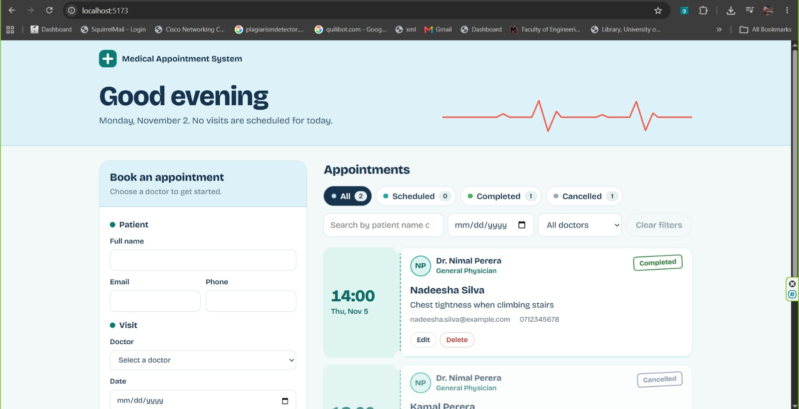

# Medical Appointment System (MERN)

A full-stack appointment management web application for a medical clinic's front desk. Built with MongoDB, Express, React (Vite) and Node.js.

## Features

- Book, view, edit, cancel, complete, re-schedule and delete appointments
- Doctor selection with live 30-minute time slots (09:00 to 16:30). Booked and past slots are crossed out and cannot be selected
- Double-booking prevention, checked in the API (409 Conflict) and enforced by a unique partial index in MongoDB
- Validation on both layers: required fields, email and phone format, no past dates
- Search by patient name or email, and filter by date and doctor
- Status tabs (All, Scheduled, Completed, Cancelled) with live counts
- Greeting header showing how many visits are scheduled today
- Each specialty has its own color, shown on the booking sheet, doctor avatar and appointment slip
- Loading, error, empty and confirmation states

## Screenshots

Add your screenshots to `docs/screenshots/` and keep these links, or edit the file names to match.




## Tech stack

| Layer | Technology |
|---|---|
| Database | MongoDB (MongoDB Atlas or local) with Mongoose |
| Backend | Node.js, Express |
| Frontend | React 18, Vite |
| Styling | Plain CSS, Bricolage Grotesque font (Google Fonts) |

## Project structure

```
medical-appointment-system/
├── server/
│   ├── server.js                      # app entry: middleware, routes, DB connect
│   ├── seed.js                        # inserts sample doctors
│   ├── config/db.js                   # MongoDB connection
│   ├── models/
│   │   ├── Doctor.js
│   │   └── Appointment.js             # schema, validation, unique partial index
│   ├── controllers/
│   │   ├── appointmentController.js   # CRUD, availability, conflict and past-date rules
│   │   └── doctorController.js
│   ├── routes/
│   │   ├── appointmentRoutes.js
│   │   └── doctorRoutes.js
│   ├── middleware/errorHandler.js     # 404 and central JSON error handler
│   └── .env.example
└── client/
    ├── index.html
    ├── vite.config.js                 # dev proxy: /api -> http://localhost:5000
    └── src/
        ├── main.jsx
        ├── App.jsx                    # state, data loading, actions
        ├── api.js                     # fetch wrapper for all API calls
        ├── dates.js                   # date formatting and greeting helpers
        ├── specialty.js               # color and initials for each specialty
        ├── styles.css
        └── components/
            ├── Header.jsx             # greeting, today's visit count, heartbeat line
            ├── AppointmentForm.jsx    # create and edit, live slot availability
            ├── AppointmentList.jsx    # appointment slips and actions
            └── FilterBar.jsx          # status tabs, search, date and doctor filters
```

## How to run

Prerequisites: Node.js 18 or newer, and a MongoDB database (a free MongoDB Atlas cluster, or a local MongoDB).

### 1. Database

**Option A: MongoDB Atlas (recommended)**

1. Create a free M0 cluster at mongodb.com/atlas.
2. Under Database Access, create a database user (use a simple alphanumeric password).
3. Under Network Access, allow your IP address (or `0.0.0.0/0` for testing).
4. Copy the connection string from Connect, then Drivers.

**Option B: local MongoDB**

Install MongoDB Community Server and make sure the MongoDB service is running.

### 2. Backend

```powershell
cd server
npm install
copy .env.example .env
```

Edit `.env` and set `MONGO_URI`. Include the database name before the `?`:

```
PORT=5000
MONGO_URI=mongodb+srv://<user>:<password>@<cluster>.mongodb.net/medical_appointments?retryWrites=true&w=majority
CLIENT_ORIGIN=http://localhost:5173
```

For a local database use `mongodb://127.0.0.1:27017/medical_appointments`.

Then seed the doctors (once) and start the API:

```powershell
npm run seed                # adds 5 sample doctors
npm run dev                 # API on http://localhost:5000
```

You should see `MongoDB connected` and `Server running on http://localhost:5000`.

### 3. Frontend (new terminal)

```powershell
cd client
npm install
npm run dev                 # app on http://localhost:5173
```

Open http://localhost:5173. In development, Vite proxies `/api` calls to the backend, so no extra CORS setup is needed.

## Troubleshooting

| Problem | Cause and fix |
|---|---|
| `ECONNREFUSED 127.0.0.1:27017` | No local MongoDB is running. Start it, or use an Atlas `MONGO_URI` in `.env` |
| `The uri parameter ... got "undefined"` | `.env` is not being read. Check that the file is named `.env` (not `.env.txt`), is in the `server` folder, and is saved as UTF-8. The line must be `MONGO_URI=...` with no spaces or quotes |
| Data appears in a database called `test` | The connection string has no database name. Add `/medical_appointments` before the `?` and run `npm run seed` again |
| Authentication failed | Username or password in `MONGO_URI` does not match the Atlas database user. Check Database Access |
| Connection timeout to Atlas | Your IP is not in Network Access, or a VPN or network blocks port 27017 |
| Doctor dropdown is empty | The seed was not run, or it ran against a different database. Run `npm run seed` |

## REST API

| Method | Endpoint | Description |
|---|---|---|
| GET | `/api/health` | Health check |
| GET | `/api/doctors` | List doctors |
| GET | `/api/appointments?date=&status=&doctor=&q=` | List appointments (all filters optional) |
| GET | `/api/appointments/availability?doctor=&date=` | Time slots with availability flags |
| GET | `/api/appointments/:id` | Get one appointment |
| POST | `/api/appointments` | Create (400 invalid, 409 slot taken) |
| PUT | `/api/appointments/:id` | Update |
| PATCH | `/api/appointments/:id/status` | Change status: `scheduled`, `completed`, `cancelled` |
| DELETE | `/api/appointments/:id` | Delete |

Example body for `POST /api/appointments`:

```json
{
  "patientName": "Kamal Perera",
  "patientEmail": "kamal@example.com",
  "patientPhone": "0771234567",
  "doctor": "<doctor _id from GET /api/doctors>",
  "date": "2026-11-10",
  "time": "10:30",
  "reason": "Routine check-up",
  "notes": ""
}
```
